# Accessibility and dark-mode pass, November 2026

A check of the screens added in quick succession before this pass (#142):
- Spot it;
- the step-free summary;
- Getting there and Show the driver;
- the passport, with its stamp on the finish screen;
- the Help sheet;
- in the admin, the place preview and the translation review.

## How it was checked

**Automated.** [axe-core](https://github.com/dequelabs/axe-core) 4 ran in Chromium against the production build (`vite preview`), with the WCAG 2.0/2.1 A and AA rules. It covered every screen in 7 combinations at phone width (390 px):

| Language | Theme | Display setting |
| --- | --- | --- |
| English | Light | Standard |
| English | Light | High contrast + Larger text |
| English | Dark | Standard |
| English | Dark | High contrast + Larger text |
| Arabic (right to left) | Light | Standard |
| Arabic (right to left) | Dark | Standard |
| Arabic (right to left) | Dark | High contrast + Larger text |

**Admin.** The admin screens were checked at 1280 px and 390 px. axe was confirmed to report a seeded unnamed button, an image with no alt text and low-contrast text before its clean results were trusted.

**By hand.** The screenshots below were reviewed for contrast that axe can't measure (over photos and gradients), Arabic layout and mixed-direction text. The page's width was also measured at 320 px.

Results: no axe violations on any of the new visitor screens in any combination, and none on the admin preview, draft review or Content tab. Fixes for what was found are listed below.

## Screen by screen

| Screen | Checked | Result |
| --- | --- | --- |
| **Route page: Getting there, step-free line** | Section heading; Directions is a link and Show the driver a button, both 44 px; text contrast in dark and high contrast; metro line in Arabic | OK |
| **Show the driver** | Dialog with a title (`aria-labelledby`), focus on open, Escape closes and focus returns; the Arabic block marked `lang="ar" dir="rtl"` in every interface language | OK |
| **Place card: Spot it, visitor tips** | Section heading; Found it! is a toggle (`aria-pressed`); Show the answer reveals text in a live region; dark surfaces | OK |
| **Passport** | Dialog title, focus, Escape; stamps readable in dark (gold ring, light text); dates with Western digits inside Arabic | OK |
| **Passport button** | On phones only the icon and "1/5" show, but the name is still read ("Passport (1 of 5 walks)") | OK |
| **Finish screen: new stamp** | Dialog; stamp and See my passport; the stamp's colours in dark | OK. In the distance tile, "≈ 220 m" breaks onto two lines with Larger text. This screen predates this pass; it is legible and left as is. |
| **Help** | Dialog title; tap-to-call links with the service named; coordinates `dir="ltr"` inside Arabic; error messages in `role="alert"`; the large-phrase view moves focus to Back and back again | OK |
| **Help, if it fails to load** | Fallback box with the emergency numbers, `role="alertdialog"`, dismissible | OK |
| **Admin: place preview** | Dialog, focus kept inside, glossary pop-ups inside the dialog, Arabic card `dir="rtl"`, no horizontal scroll at 390 px | OK |
| **Admin: draft review, Translations to review** | `role="note"` box, Mark reviewed buttons; language filters as toggles (`aria-pressed`); Edit links named after the item | OK |

## Fixed in this pass

1. **Routes header at 320 px with Larger text.** The Passport and Saved buttons, added beside the "Routes" heading, pushed the page 30 px wider than the screen, so it scrolled sideways. The row now wraps: the buttons go to a second line when they don't fit. Normal sizes are unchanged.
   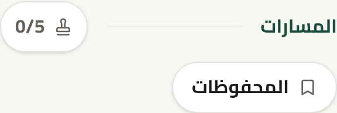
2. **Map pin in the location picker** (the admin place editor and the visitor's Report a problem). Leaflet makes the draggable pin a focusable button, and it had no name (axe `aria-command-name`). It now has one in each language: "The chosen spot: drag it, or tap the map".

## Screenshots

| | |
| --- | --- |
| 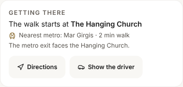 | 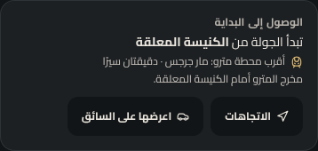 |
| 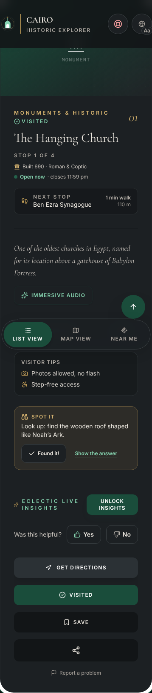 | 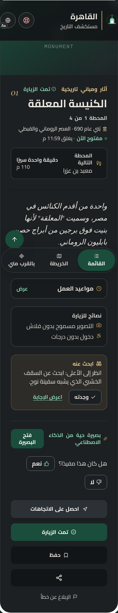 |
| 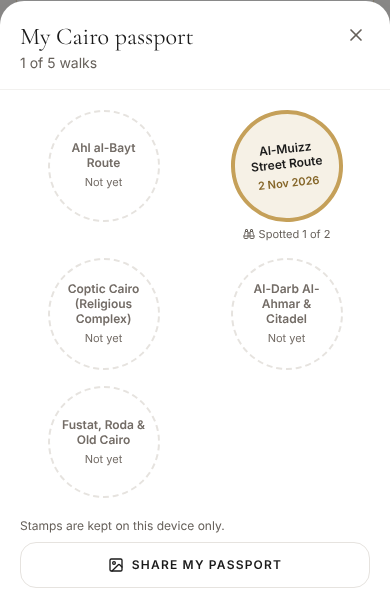 | 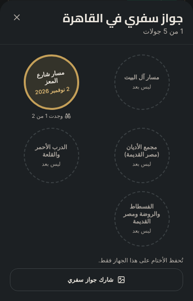 |
| 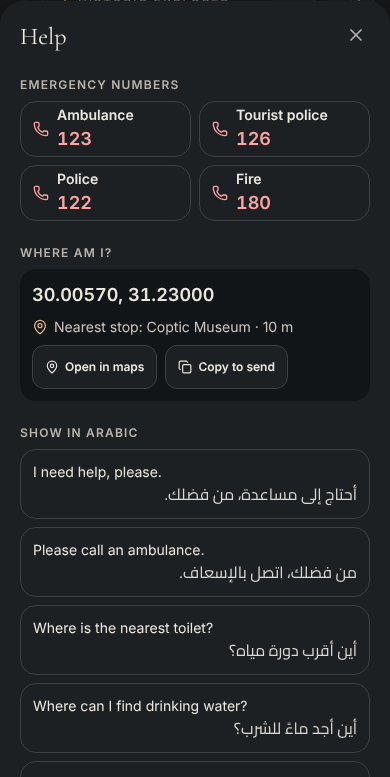 | 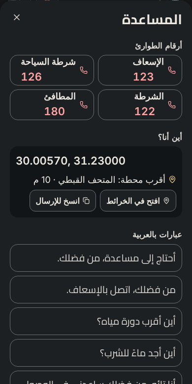 |
| 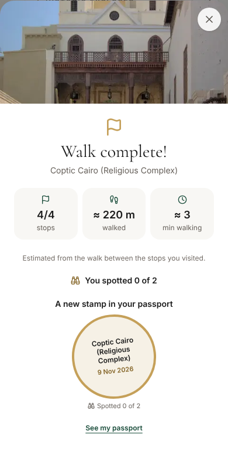 | 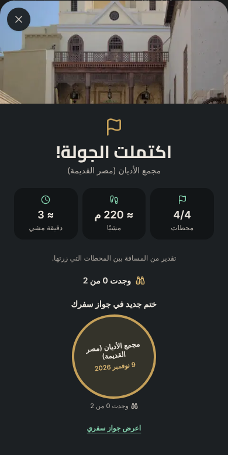 |
| 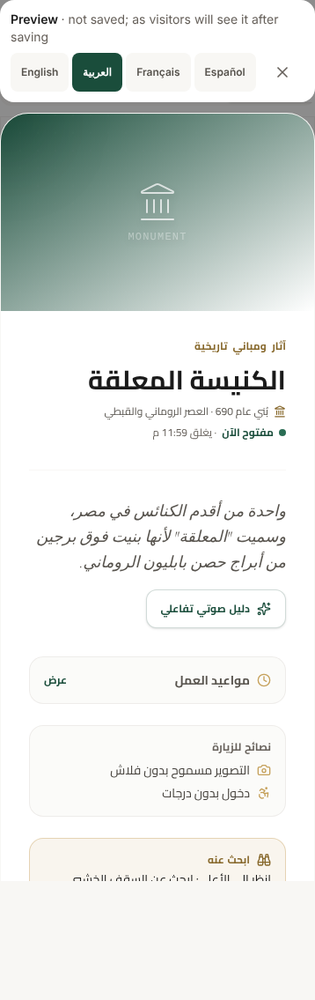 | 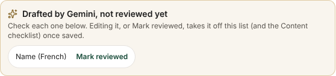 |

## Not covered

- **Moving the map pin by keyboard.** Leaflet doesn't support dragging a pin with the keyboard. Report a problem also offers "I’m standing here now" (the phone's position), and the admin editor has latitude and longitude fields, so keyboard users have another way to set the spot.
- **Screen readers on real devices** (VoiceOver, TalkBack): this pass used automated rules and the accessibility tree. A short manual pass on a phone is worth doing before a big launch.
